<div align="center">

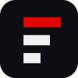

# Pit Wall

**F1 live timing, track map and telemetry in one window you arrange yourself.**<br>
Live and past sessions, the championship, a race-day brief and the calendar, with your F1 TV login.

Chrome · Edge · Brave · Arc · Opera · Vivaldi · Dia &nbsp;—&nbsp; any Chromium browser

[](https://github.com/MarcusLai07/f1-pitwall/releases/latest)
[](LICENSE)
[](https://github.com/sponsors/MarcusLai07)

<br>

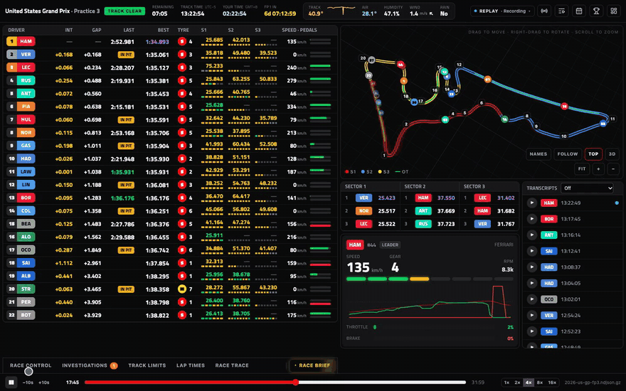

<sub>[▶ Watch in full quality (MP4)](docs/media/demo.mp4)</sub>

</div>

## Install

**macOS**, in one line:

```bash
curl -fsSL https://raw.githubusercontent.com/MarcusLai07/f1-pitwall/main/install.sh | bash
```

It downloads the latest release to `~/PitWall`, copies that folder's path to your clipboard and opens your browser's extensions page (your default browser if it's Chromium-based, otherwise the first Chromium browser it finds). Then:

1. Turn on **Developer mode** (top right).
2. Click **Load unpacked** → press **⌘⇧G** → **⌘V** → Return → **Select**.
3. Pin Pit Wall from the 🧩 menu and click it.

**Update:** run the same line again, then click ↻ on Pit Wall in the extensions page.

<details>
<summary><b>Windows, Linux, other browsers, options and uninstall</b></summary>

<br>

| | |
|---|---|
| Any OS, any Chromium browser | Download `pit-wall.zip` from [the latest release](https://github.com/MarcusLai07/f1-pitwall/releases/latest) and unzip it somewhere it can stay. Open the browser's extensions page (`chrome://extensions`, `edge://extensions`, `brave://extensions`, `opera://extensions`, `vivaldi://extensions`…), turn on **Developer mode**, click **Load unpacked** and pick that folder. To update, unzip the new one over it and click ↻. |
| A different browser (macOS) | `curl -fsSL …/install.sh \| PITWALL_BROWSER="Brave Browser" bash` opens that browser's extensions page instead |
| Several browsers | Load the same folder in each. Each browser keeps its own F1 TV sign-in and layouts. |
| Somewhere else | `… \| bash -s -- --dir ~/Apps/PitWall` |
| Uninstall | `… \| bash -s -- --uninstall`, then remove Pit Wall from the extensions page |

**Why the manual click?** Browsers only let you add an extension from outside their store through *Load unpacked*. No script is allowed to do it for you.

</details>

## What it does

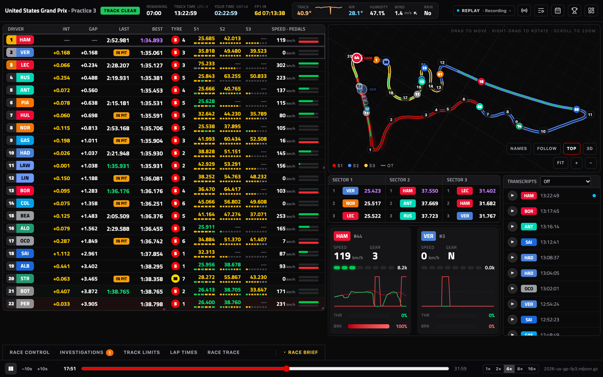

One window you lay out yourself: the timing tower, a track map, telemetry, team radio and the sector leaderboard, with a drawer for race control and lap data underneath. The header has the time and laps remaining, track and local time, and the weather.

<table>
<tr>
<td width="50%" valign="top">
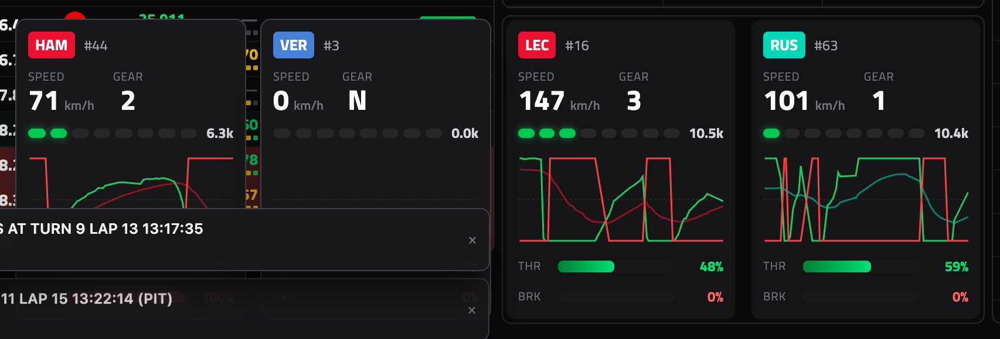
<br><b>Telemetry for up to five cars.</b> Click drivers in the tower for their speed, gear, RPM, throttle and brake. Two cards sit in the widget; the rest open out to its left.
</td>
<td width="50%" valign="top">
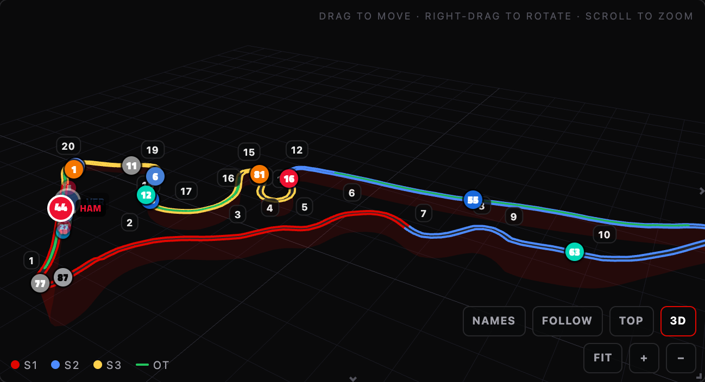
<br><b>3D track map with the pit lane.</b> The track at its real width, edged in sector colours, with each car as a numbered team-coloured dot and the pit lane alongside. Drag, rotate, zoom or follow a driver.
</td>
</tr>
<tr>
<td valign="top">
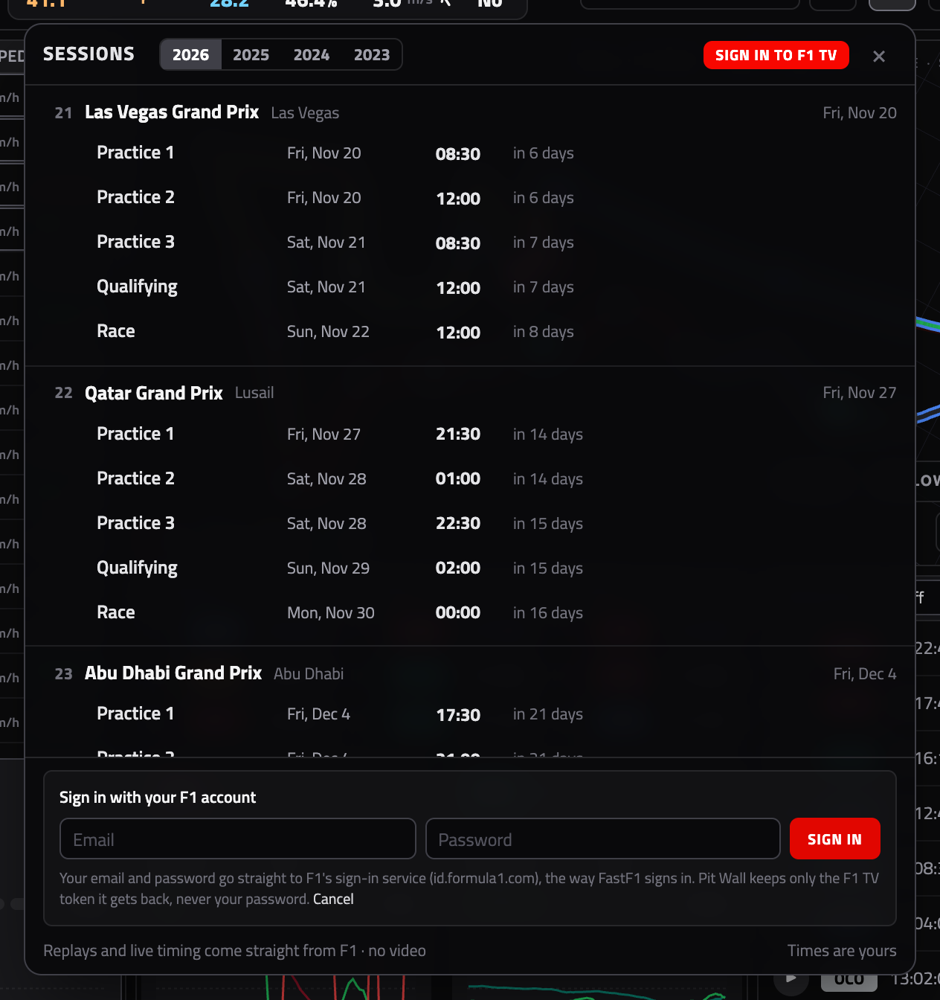
<br><b>Every session, live or past.</b> Follow a live session or replay any past one from F1's archive. Sign in with your F1 account; the password goes only to F1.
</td>
<td valign="top">
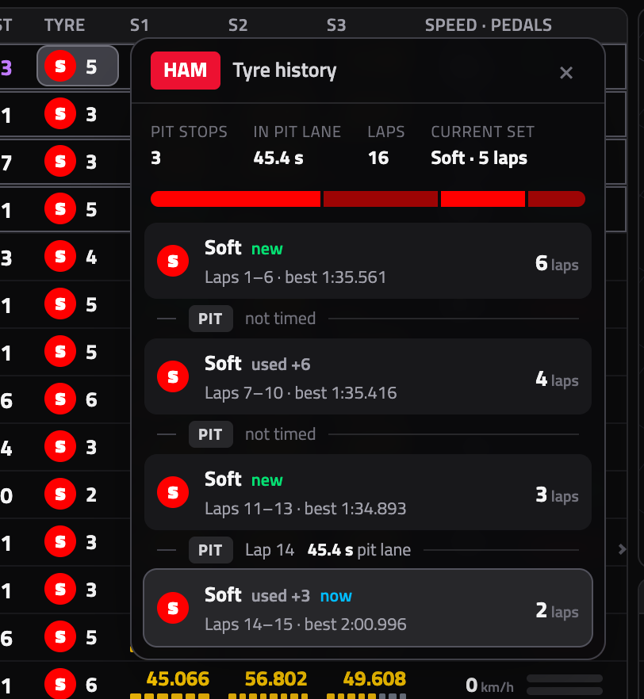
<br><b>Tyre history.</b> Click a driver's tyre for every set, new or used, the laps run on it, its best lap, and each pit stop in between.
</td>
</tr>
<tr>
<td valign="top">
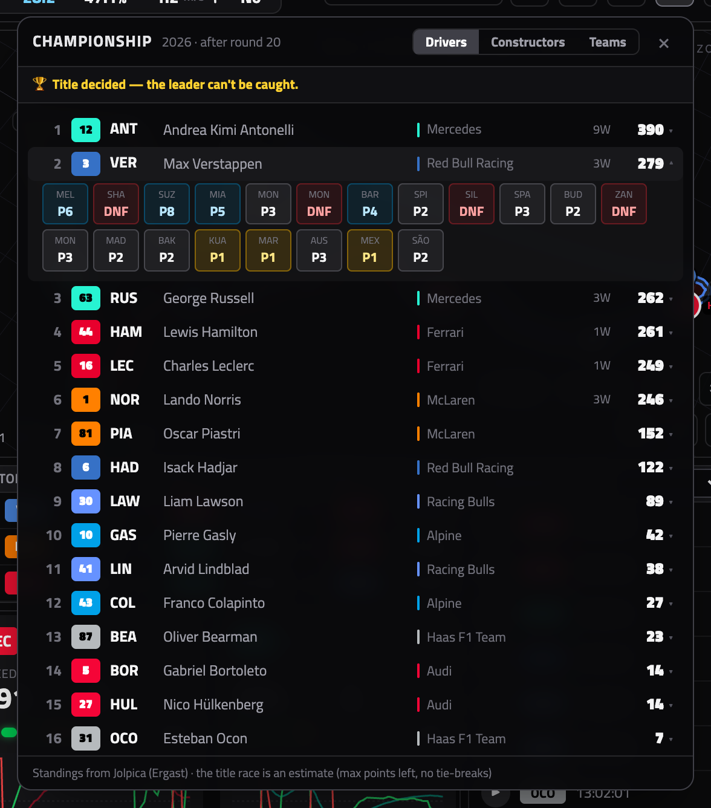
<br><b>Championship and the title race.</b> Drivers' and constructors' standings, who can still win and when it's clinched, and each driver's season race by race.
</td>
<td valign="top">
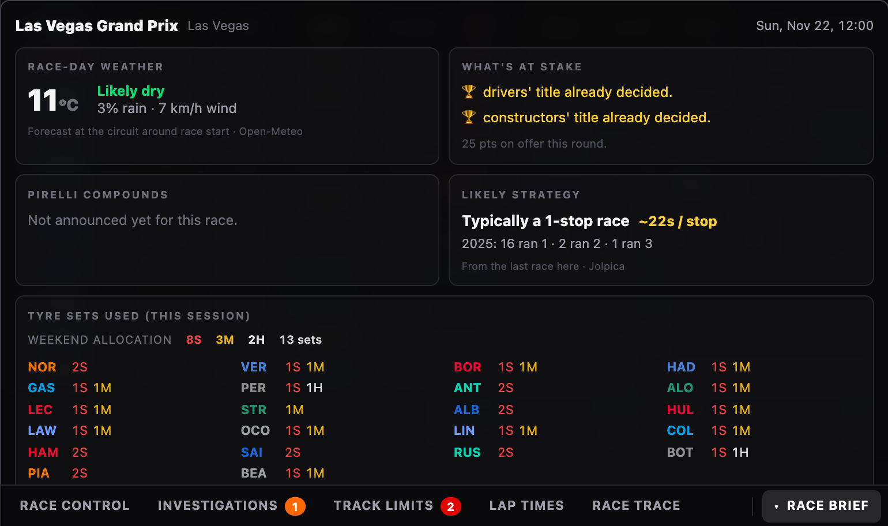
<br><b>Pre-race brief.</b> The race-day forecast, what's at stake, the Pirelli compounds, the likely number of stops and what each costs here, and the tyre sets used against the weekend's allocation.
</td>
</tr>
<tr>
<td valign="top">
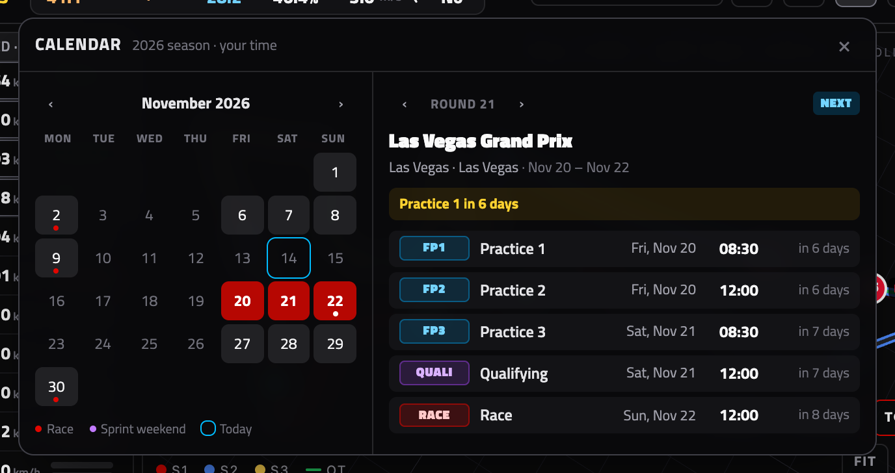
<br><b>The season at a glance.</b> A month grid in your time zone with race weekends marked (sprints in purple), beside the round's sessions and a countdown.
</td>
<td valign="top">
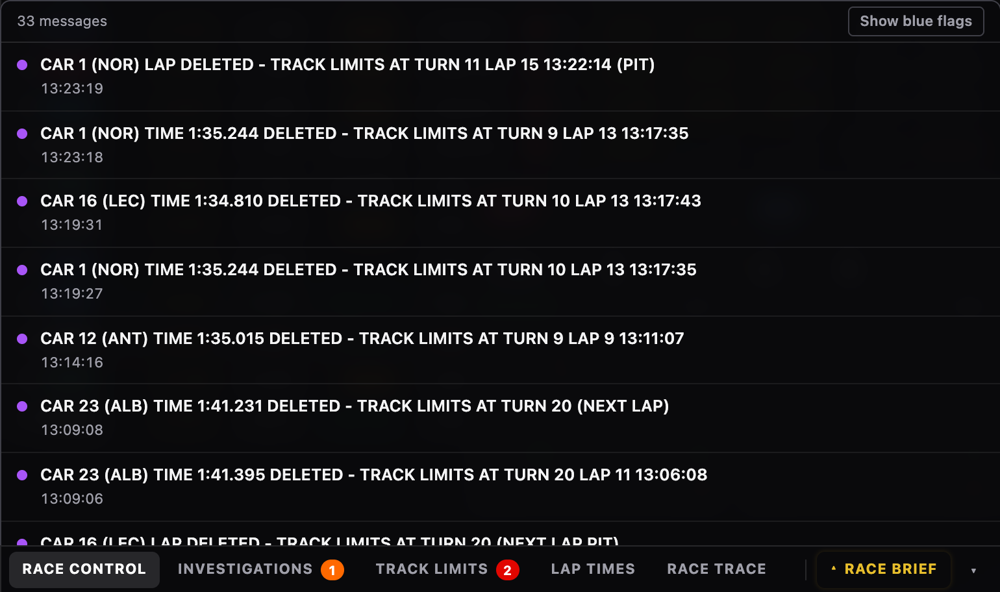
<br><b>Race control and lap data.</b> A drawer under the tower holds race control, investigations, track limits, every lap time and the race trace. New messages pop up above it.
</td>
</tr>
</table>

<details>
<summary><b>The full guide</b></summary>

<br>

- **Sessions:** every session of a season, past, live and upcoming, in your time zone. **Replay** plays a past one from F1's archive and **Follow** switches to live. Your F1 TV sign-in sits top right.
- **Replay bar:** space plays and pauses; the bar has seek, ±10 s and 1–16× speed. Replays start a minute before the session's clock starts. **Go live** switches back.
- **Source chip** (top right, e.g. *Live · F1 TV · 3 s behind* or *Replay · F1 TV archive*): what the board shows and where it comes from. Click it to set the live delay and see which topics F1 is sending.
- **Header:** time remaining (and laps to go in races), **Track time** next to **Your time**, and a weather strip. With nothing live it looks ahead to the next session with a countdown.
- **Timing tower:** in races a green/red badge shows places gained or lost since the start (hover for the grid slot). Mini-sectors sit under each sector time. Pit stops show the official pit-lane time plus the time stood still, estimated from car data (±0.3 s). Live, stops and laps count from when Pit Wall starts watching; archive sessions have them all.
- **Drivers:** click up to five in the tower. Telemetry shows the two most recent in the widget and the rest as floating cards; the map highlights them and **follow** tracks the most recent one.
- **Track map:** **names** adds every driver's code. In races, while race control has overtake enabled, cars within a second of the car ahead get a green ring (estimated from the live interval). Drag to move, right-drag (or Shift + drag) to rotate and tilt, scroll to zoom, double-click or **fit** to frame the track. A new fastest lap (provisional pole in Q3) or leader drops in as a banner. If F1 moves the coordinate frame or there's no stored track shape, the map re-aligns or draws the track from a live lap, and remembers it per circuit and season.
- **Team radio:** play any clip. Set **Transcripts** to *Standard* (about 250 MB) or *Light* (about 80 MB) to transcribe clips on your computer with OpenAI's Whisper, in the browser. The model downloads once and transcripts are kept.
- **Drawer:** Race control, Investigations (each incident's latest status and penalty), Track limits (strikes per driver), Lap times (every lap with tyres) and Race trace (gap to the leader by lap; lap times in practice and qualifying). The amber tab at the right opens the **Race brief**.
- **Championship** (trophy button): the **Teams** tab lists each team's engine, base and drivers. From Jolpica, so it works with no live session.
- **Layout:** hover a widget's top edge to slide its title bar down, then drag to move and resize from the edges. The **Layout** menu adds or removes widgets, locks the layout, switches between *snap upward* and *free placement*, resets it, and sets the **UI size**.
- **Any screen:** the window is laid out for a ~900 px tall screen and scales to the real one. Nothing scrolls; widgets resize to fit. The window remembers its size and position.
- **Side panel:** right-click the toolbar button → **Open in side panel** for a compact one-column view next to whatever you're browsing (Chrome, Edge, Brave and others with Chrome's side panel). Narrow windows use the same layout.

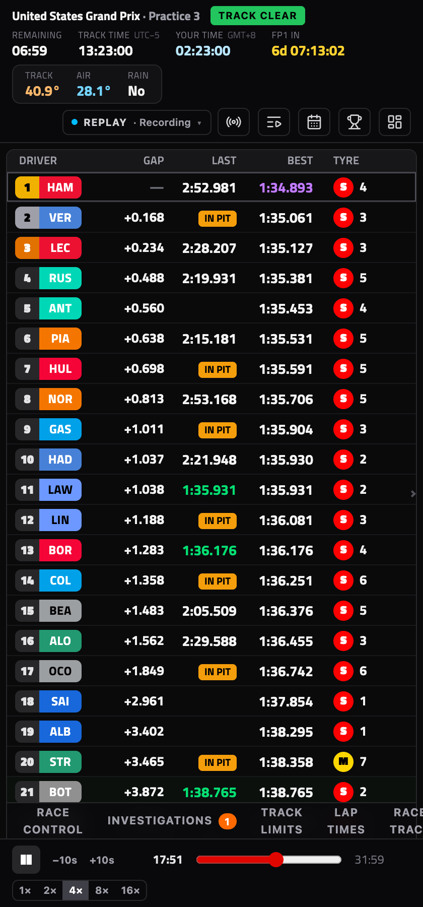

</details>

## Where the data comes from

Straight from the source, in your browser. Pit Wall has no server.

- **Live timing:** F1's live timing feed. Without signing in you get F1's free feed: timing, sectors and race control. **Sign in to F1 TV** (top right of **Sessions**) to add cars on the map, telemetry and team radio. F1's feed runs ahead of most video streams, so raise **Delay** in the source chip until the timing matches what you're watching.
- **Past sessions:** **Sessions → Replay** loads any past session's timing, positions, telemetry and team radio from F1's timing archive (the one FastF1 uses). Needs the F1 TV sign-in.
- **Standings, calendar and brief:** standings from [Jolpica](https://github.com/jolpica/jolpica-f1) (the Ergast continuation), the schedule from [OpenF1](https://openf1.org) (F1's archive index as a fallback), race-day weather from [Open-Meteo](https://open-meteo.com), and the Pirelli compounds from a small [data file](data/nominations.json) in this repo. None needs a sign-in.
- **Video:** Pit Wall shows data only. Watch wherever you normally do and set the **Delay** to match. It doesn't use F1 TV's video, so it also works where F1 TV blocks live streams.

<details>
<summary><b>Signing in, permissions and notes</b></summary>

<br>

- **Signing in:** Pit Wall signs in to F1's own sign-in service (`id.formula1.com`) the way [FastF1](https://docs.fastf1.dev) does. Your email and password go only to F1; Pit Wall keeps just the F1 TV token F1 gives back, in the extension's own storage, and only sends it to F1's live timing and archive at `livetiming.formula1.com`. If this browser is already signed in to F1, it may not ask. The token lasts a few days. Click your plan's name (e.g. **F1 TV Pro ▾**) to **Sign out of Pit Wall**, which deletes it.
- **Permissions:** `*.formula1.com` to sign in and reach the live feed and archive (team radio too), `cookies` to pick up a formula1.com login left in a cookie, and `api.openf1.org`, `api.jolpi.ca`, `api.open-meteo.com` and `raw.githubusercontent.com` for the schedule, standings, weather and tyre nominations.
- F1's live feed and archive are unofficial interfaces and could change without notice.
- Circuits without a stored shape (e.g. Madring) show a map after about one lap of running, drawn from live positions (no sector colours or turn numbers there).
- For personal use. Don't redistribute the timing data.

</details>

## Support

Pit Wall is free and built for the love of the sport. If it's made your race weekends better, you can chip in from anywhere, by card: [**❤ Sponsor on GitHub**](https://github.com/sponsors/MarcusLai07). Every bit keeps the updates coming. Thank you! 🏁

<details>
<summary><b>For developers</b></summary>

<br>

Needs Node 20+.

```bash
npm install
npm run dev     # dev page
npm run build   # the extension, in dist/ (Load unpacked → dist)
```

The dev page opens on [localhost:5288/window.html](http://localhost:5288/window.html) (or `/sidepanel.html`). The dev server proxies `/f1live` to F1's live feed, `/f1static` to its archive and `/jolpi` to Jolpica, because none send CORS headers; the built extension uses `host_permissions` instead. F1 TV sign-in only works in the built extension; the dev page shows *F1 TV · extension only*.

- `?replay=/recordings/<file>` loads a saved live-feed recording (gzip NDJSON, one state per line) from `recordings/`.
- `?archive=<session path>&archiveBase=/recordings/archive/` plays a saved copy of an archive session, e.g. `recordings/archive/2024/2024-10-27_Mexico_City_Grand_Prix/2024-10-27_Race/` holding its `.jsonStream` files.

**Tyre nominations:** `data/nominations.json` holds Pirelli's compounds per race (by season then city). Pit Wall fetches it live from GitHub, so editing it on `main` updates every copy with no release: `node scripts/update-nominations.mjs --season 2026 --city "Mexico City" --compounds C3,C4,C5`.

**Weekend data:** the Race Brief's Tyres, Rules and Grid & penalties tabs (and the tower's C-numbers and stint-limit warnings) come from the FIA's event documents. `scripts/update-weekend.mjs` reads them (needs `pdftotext` from poppler) and the *Weekend data* workflow runs it every 15 min Thu–Sun, publishing `weekend.json` on the `weekend-data` branch that every copy fetches. What the PDFs don't carry as text (a stint limit drawn as a graphic) and the plain-English rule notes go in `data/weekend-overrides.json` on `main`. Running the script locally writes `data/weekend.json`, which the dev page prefers.

**Releasing:** bump the version in `package.json` and `public/manifest.json`, then `git tag vX.Y.Z && git push origin vX.Y.Z`. The Release workflow builds the extension, stamps the tag's version into its manifest and attaches `pit-wall.zip` to a GitHub release, which `install.sh` downloads.

**README media:** `npm run build && node scripts/capture-media.mjs recordings/<recording>.ndjson.gz` records `docs/media` (the screenshots, `demo.mp4` and `demo.gif`) by driving the built extension in headless Chrome for Testing (`npx playwright-core install chromium`) through a saved session. F1's sign-in is answered with stand-ins and the season schedule is served from `scripts/media/season-<year>.json`; the championship, weather and Pirelli nomination come from their live sources. Needs ffmpeg; `CHROME=` picks another browser binary.

Code map:

- `src/data/`: F1 live feed client (`f1live.ts`), F1 archive loader (`archive.ts`), replay engine, store, sample buffers for car positions and telemetry, and `derive.ts`, which turns raw F1 topics into tower rows.
- `src/sessions/`: the session picker and its schedule (`catalog.ts`), the F1 TV sign-in (`f1login.ts`, `f1account.ts`), the championship (`championship.ts`, `ChampionshipPanel.tsx`) and the calendar (`CalendarPanel.tsx`).
- `src/drawer/`: the drawer tabs and the pre-race brief (`RaceBrief.tsx`, `raceWeather.ts`, `weekendTyres.ts`).
- `src/widgets/`: the widgets. The timing tower, telemetry and track map are adapted from `f1-dashboard`.
- `src/circuit3d/`, `src/circuits/`: the three.js circuit engine and the FastF1-derived track geometry, copied from `f1-dashboard`.
- `src/layout/`: grid layout, defaults and persistence.

</details>

<br>

<sub>Not affiliated with Formula 1 or F1 TV. MIT licensed.</sub>
