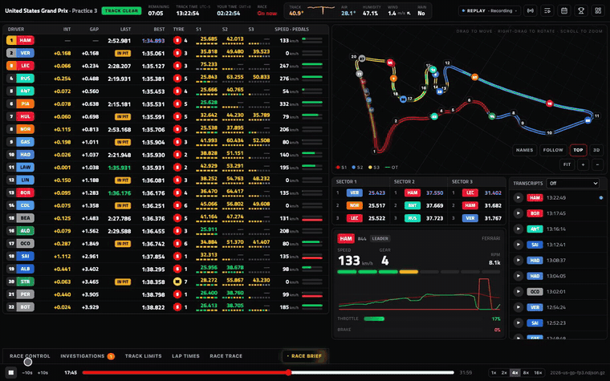
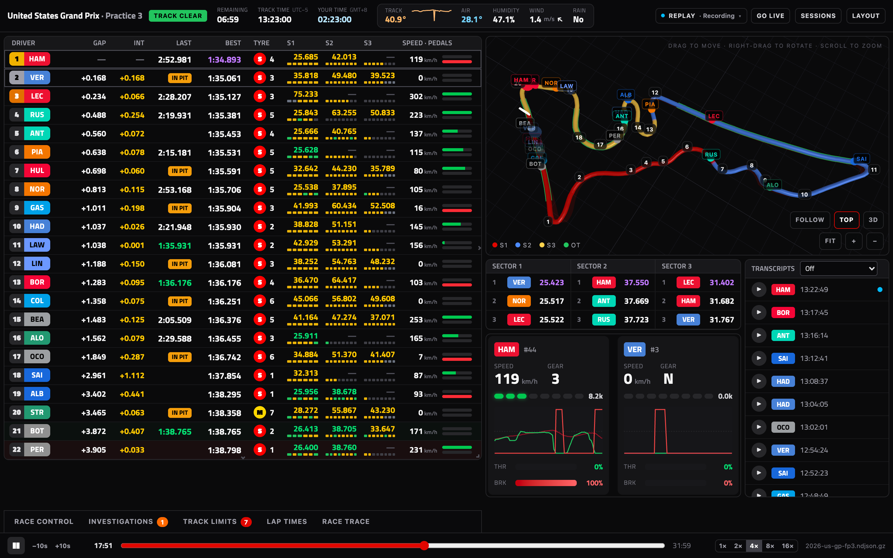
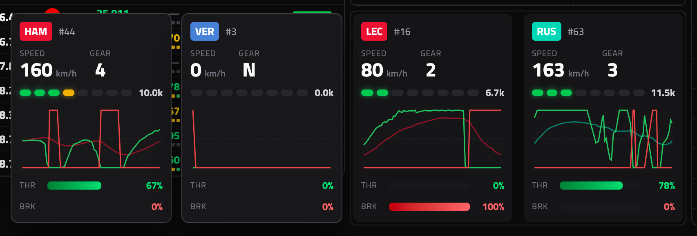
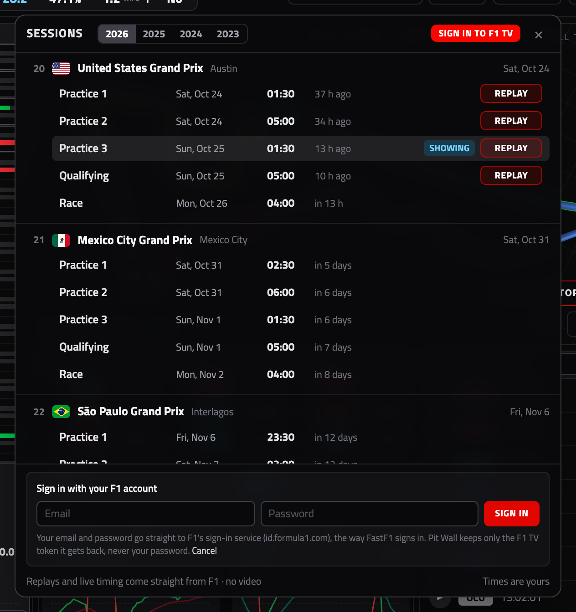
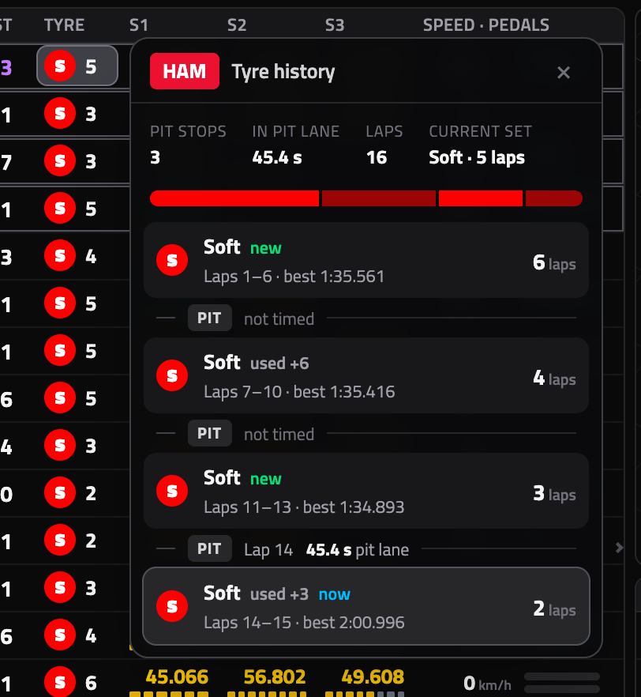
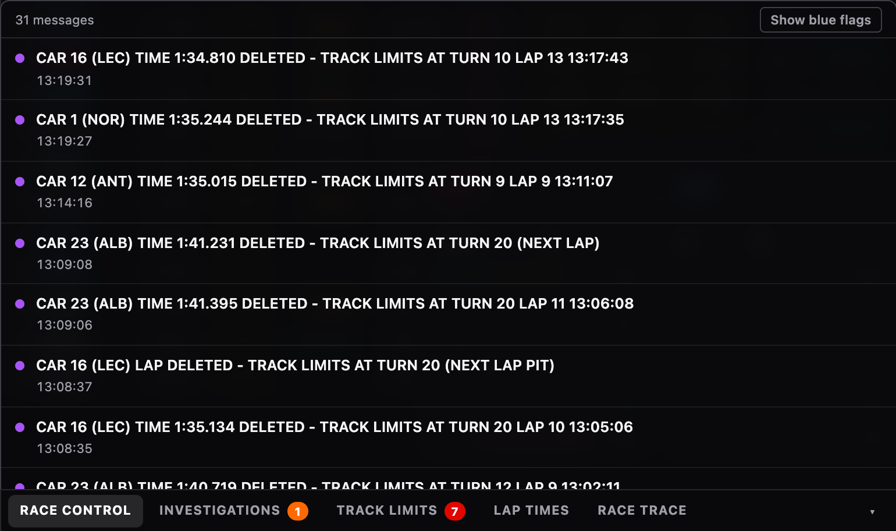
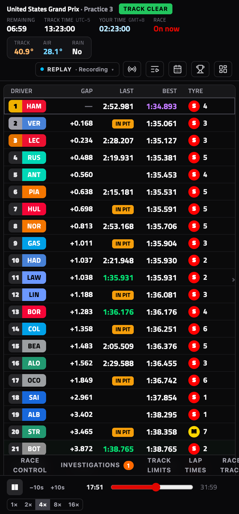

<div align="center">

# Pit Wall

**F1 live timing, track map and telemetry in one window you arrange yourself.**<br>
Live and past sessions, straight from F1 with your F1 TV login.

A browser extension for Chrome, Edge, Brave, Arc, Opera, Vivaldi, Dia and other Chromium browsers



<sub>[▶ Watch in full quality (MP4)](docs/media/demo.mp4)</sub>

</div>

## Install in one line (macOS)

```bash
curl -fsSL https://raw.githubusercontent.com/MarcusLai07/f1-pitwall/main/install.sh | bash
```

It downloads the latest release to `~/PitWall`, copies that folder's path to your clipboard and opens your browser's extensions page: your default browser if it's Chromium-based, otherwise the first Chromium browser it finds. Then:

1. Turn on **Developer mode** (top right).
2. Click **Load unpacked** → press **⌘⇧G** → **⌘V** → Return → **Select**.
3. Pin Pit Wall from the 🧩 menu and click it.

**Update:** run the same line again, then click ↻ on Pit Wall in the extensions page.

<details>
<summary><b>Windows, Linux, other browsers, options and uninstall</b></summary>

<br>

| | |
|---|---|
| Any OS, any Chromium browser | Download `pit-wall.zip` from [the latest release](https://github.com/MarcusLai07/f1-pitwall/releases/latest) and unzip it somewhere it can stay. Open the browser's extensions page (`chrome://extensions`, `edge://extensions`, `brave://extensions`, `opera://extensions`, `vivaldi://extensions`…), turn on **Developer mode**, click **Load unpacked** and pick that folder. To update, unzip the new one over it and click ↻. |
| A different browser (macOS) | `curl -fsSL …/install.sh \| PITWALL_BROWSER="Brave Browser" bash` opens that browser's extensions page instead |
| Several browsers | Load the same folder in each. Each browser keeps its own F1 TV sign-in and layouts. |
| Somewhere else | `… \| bash -s -- --dir ~/Apps/PitWall` |
| Uninstall | `… \| bash -s -- --uninstall`, then remove Pit Wall from the extensions page |

**Why the manual click?** Browsers only let you add an extension outside their store through *Load unpacked*. No script is allowed to do it for you.

</details>

## What it does



<table>
<tr>
<td width="50%" valign="top">

<b>Telemetry for up to five cars.</b> Click drivers in the timing tower for their speed, gear, RPM, throttle and brake. Two cards sit in the widget; the rest open out to the left at the same size.
</td>
<td width="50%" valign="top">

<b>Every session, live or past.</b> Follow a live session, or replay any past one from F1's archive. Sign in with your F1 account: the password goes only to F1.
</td>
</tr>
<tr>
<td valign="top">

<b>Tyre history.</b> Click a driver's tyre: every set, new or used, the laps run on it, its best lap, and each pit stop in between.
</td>
<td valign="top">

<b>Race control and lap data.</b> A drawer under the tower holds race control, investigations, track limits, every lap time and the race trace. New messages pop up above it.
</td>
</tr>
</table>

<details>
<summary><b>The side panel view</b></summary>

<br>



Right-click Pit Wall's toolbar button → **Open in side panel** for a one-column view next to whatever you're browsing (in browsers with Chrome's side panel, such as Chrome, Edge and Brave).

</details>

## Where the data comes from

Straight from F1, in your browser. Pit Wall has no server.

- **Live:** F1's live timing feed. Without signing in you get F1's free feed: timing, sectors and race control. **Sign in to F1 TV** (top right of **Sessions**) to add cars on the map, telemetry and team radio. F1's feed runs ahead of most video streams, so open the source menu (the **Live · F1** chip) and raise **Delay** until the timing matches what you're watching.
- **Past sessions:** **Sessions → Replay** loads any past session's timing, track positions, telemetry and team radio from F1's timing archive (the one FastF1 uses). It needs the F1 TV sign-in. There's no video; scrub with the replay bar.
- **Signing in:** click **Sign in to F1 TV** at the top right of **Sessions** and enter your F1 account's email and password. Pit Wall signs in to F1's own sign-in service (`id.formula1.com`) the way [FastF1](https://docs.fastf1.dev) does: your email and password go only to F1, and Pit Wall keeps just the F1 TV token F1 gives back (in the extension's own storage), never the password. If this browser is already signed in to F1, it may not even ask. The token lasts a few days; sign in again when Sessions says it ran out. Click your plan's name (e.g. **F1 TV Pro ▾**) to **Sign out of Pit Wall**, which deletes the token. (formula1.com used to leave the token in a cookie; Pit Wall still uses one if it finds it.)
- **Video:** Pit Wall shows data only. Watch the session wherever you normally do and set the **Delay** to match it. It doesn't depend on F1 TV's video, so it also works where F1 TV blocks live streams or current-season replays.

## Use

- **Sessions:** every session of a season, past, live and upcoming, in your time zone. **Replay** plays a past one from F1's archive and **Follow** switches to live. Your F1 TV sign-in sits top right.
- **Race brief:** the amber tab at the right of the drawer bar opens a pre-race brief for the next race — the weather forecast (Open-Meteo), what's at stake in the title race, the Pirelli compound nomination, the likely strategy (typical stop count from past races at the circuit), the tyre sets each driver has used in the running session, and a circuit guide (length, laps, DRS zones, lap record).
- **Championship:** the trophy button opens the drivers' and constructors' standings with the title race (how many can still win, points left, and when it's clinched), plus the team and driver roster. Standings come from Jolpica (the Ergast continuation); it works with no live session.
- **Calendar:** the season at a glance: a month grid in your time zone with the race weekends marked (sprint weekends in purple), and the picked round's sessions with their times and a countdown.
- **Source chip** (top right, e.g. *Live · F1 TV · 3 s behind* or *Replay · F1 TV archive*): what the board shows and where it comes from. Click it to set the live delay.
- **Toolbar button:** opens Pit Wall in its own window (or focuses it). The window remembers its size and position.
- **Any screen:** the window is laid out for a ~900 px tall screen and scales to the real one, so a big monitor gets the same layout, just larger; other aspect ratios only stretch the columns. Nothing scrolls: widgets resize to fit the height. **Layout → UI size** makes everything bigger or smaller.
- **Right-click the toolbar button → Open in side panel:** the compact one-column view, in browsers that have Chrome's side panel (Chrome, Edge, Brave and others). Narrow windows (under 760 px) use the same layout.
- **Header:** session time remaining, **Track time** (the circuit's time zone) next to **Your time** (the same moment in your time zone), and a weather strip. With nothing live it looks ahead: the next session (e.g. *NEXT · United States Grand Prix · Race*) and a countdown to it.
- **Timing tower:** in races a green/red badge by each driver shows the places they've gained or lost since the start (hover for their grid slot). Mini-sectors sit under each sector time. Click a driver's tyre for their tyre history: every set, new or used, the laps run on it and its best lap, with each pit stop in between (official pit-lane time, plus the time stood still estimated from car data, ±0.3 s). Live, stops are timed from when Pit Wall starts watching; sessions loaded from F1's archive have every stop.
- **Click drivers** in the timing tower to select them (up to five). Telemetry shows the two most recent in the widget; cars 3–5 open out to its left as floating cards of the same size. The map highlights them and **follow** tracks the most recent one.
- **Track map:** the track is drawn as a road at its real width, edged in the sector colours with the overtake zones down the middle, and each car is a team-coloured dot with its number (leader on top; **names** adds every driver's code, selected drivers always show theirs). Zoom in, or turn on **follow**, to see who's on the inside. In a race, while race control has overtake enabled, cars within a second of the car ahead get a green ring (estimated from the live interval; 2026's car data has no overtake signal). Drag to move it, right-drag (or Shift + drag) to rotate and tilt, scroll to zoom, double-click or **fit** to frame the whole track again. A new fastest lap (provisional pole in Q3) and, in races, a new leader drop in as banners at the top of the map. It checks the stored track shape against where cars actually drive: if F1 has moved the coordinate frame it re-aligns the shape, and if the layout doesn't match at all (or there's no stored shape) it draws the track from a live lap instead. The result is remembered per circuit and season.
- **Team radio:** play any clip. Set **Transcripts** to *Standard* (about 250 MB) or *Light* (about 80 MB) to transcribe clips on your computer with OpenAI's Whisper, right in the browser; the model downloads once and transcripts are kept.
- **Drawer** (under the timing tower): Race control, Investigations (each incident's latest status and any penalty), Track limits (strikes per driver), Lap times (every lap by driver, with tyres) and Race trace (gap to the leader by lap; lap times in practice and qualifying). New race control messages pop up above it; click one to open its tab. Live, lap times and race trace start from when Pit Wall starts watching; sessions loaded from F1's archive have every lap.
- **Layout:** hover the top edge of a widget to slide its title bar down, then drag it to move and resize from the edges. The grid moves in steps of one timing row, and the tower stops growing at the last driver. The **Layout** menu adds or removes widgets, locks the layout, switches between *snap upward* (default) and *free placement*, and resets to the default.

## Replay

Past sessions loaded from **Sessions** play in the replay bar. Space plays and pauses; the bar has seek, ±10 s and 1–16× speed. Replays start a minute before the session's clock starts. **Go live** switches back.

## Develop

Needs Node 20+.

```bash
npm install
npm run dev     # dev page
npm run build   # the extension, in dist/ (Load unpacked → dist)
```

The dev page opens on [localhost:5288/window.html](http://localhost:5288/window.html) (or `/sidepanel.html`). The dev server proxies `/f1live` to F1's live feed and `/f1static` to its archive, because neither sends CORS headers; the built extension uses `host_permissions` instead. F1 TV sign-in only works in the built extension, which has host permissions for F1's sign-in service; the dev page shows *F1 TV · extension only*.

- `?replay=/recordings/<file>` loads an older MultiViewer recording (gzip NDJSON, one state per line) from `recordings/`.
- `?archive=<session path>&archiveBase=/recordings/archive/` plays a saved copy of an archive session, e.g. `recordings/archive/2024/2024-10-27_Mexico_City_Grand_Prix/2024-10-27_Race/` holding its `.jsonStream` files.

**Tyre nominations:** `data/nominations.json` holds Pirelli's compounds per race (by season then city); Pit Wall fetches it live from GitHub, so editing it on `main` updates every copy with no release. Update it with `node scripts/update-nominations.mjs --season 2026 --city "Mexico City" --compounds C3,C4,C5`.

**Releasing:** bump the version in `package.json` and `public/manifest.json`, then `git tag vX.Y.Z && git push origin vX.Y.Z`. The Release workflow builds the extension, stamps the tag's version into its manifest and attaches `pit-wall.zip` to a GitHub release, which `install.sh` downloads.

**README media:** `npm run build && node scripts/capture-media.mjs recordings/<recording>.ndjson.gz` records `docs/media` (the screenshots, `demo.mp4` and `demo.gif`) by driving the built extension in headless Chrome for Testing through a saved session. F1's sign-in is answered with stand-ins, so nothing is sent to F1. Needs ffmpeg; `CHROME=` picks another browser binary.

Code map:

- `src/data/`: F1 live feed client (`f1live.ts`), F1 archive loader (`archive.ts`), replay engine, store, sample buffers for car positions and telemetry, and `derive.ts`, which turns raw F1 topics into tower rows.
- `src/sessions/`: the session picker, its schedule (OpenF1, or F1's archive index while OpenF1 is closed during live sessions) and the F1 TV sign-in.
- `src/widgets/`: the widgets. The timing tower, telemetry and track map are adapted from `f1-dashboard`.
- `src/circuit3d/`, `src/circuits/`: the three.js circuit engine and the FastF1-derived track geometry, copied from `f1-dashboard`.
- `src/layout/`: grid layout, defaults and persistence.

## Notes

- F1's live feed and archive are unofficial interfaces and could change without notice.
- Permissions: `*.formula1.com` to sign in to F1 and reach its live feed and archive (team radio clips come from there too), `cookies` to pick up a formula1.com login left in a cookie, `api.openf1.org` for the schedule.
- Your F1 TV token stays in your browser. Pit Wall only sends it to F1's own live timing and archive at `livetiming.formula1.com`; your password only ever goes to `id.formula1.com`.
- Circuits without a stored shape (e.g. Madring) or with a different layout show a map after about one lap of running, drawn from live positions (no sector colours or turn numbers there).
- For personal use. Don't redistribute the timing data.
